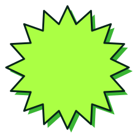
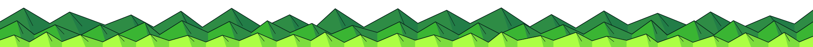
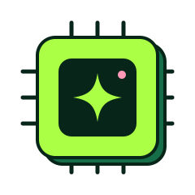
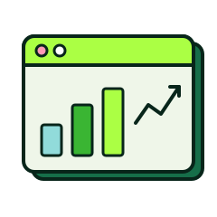
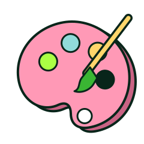
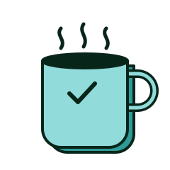

```{=html}
<section class="fn-hero fn-hero--mountains">
  
  
  
  <h1 class="display extrude">StellarGrok</h1>
  <p class="lead">Personal notes on Bits, Bytes and Bots</p>
</section>

<div class="fn-sections">
  <a class="fn-tile" href="sections/ai.qmd"><div class="art bg-lime"></div><strong>AI</strong><span>Models, evals and the odd agent</span></a>
  <a class="fn-tile" href="sections/data.qmd"><div class="art bg-mint"></div><strong>Data</strong><span>Analysis, charts and pipelines</span></a>
  <a class="fn-tile" href="sections/art.qmd"><div class="art bg-pink"></div><strong>Art</strong><span>Generative and creative coding</span></a>
  <a class="fn-tile" href="sections/leadership.qmd"><div class="art bg-sage"></div><strong>Leadership</strong><span>Teams, decisions and growth</span></a>
  <a class="fn-tile" href="sections/other.qmd"><div class="art bg-cream"></div><strong>Other</strong><span>Everything else</span></a>
</div>
```

## Latest posts {.fn-home-heading}

::: {#latest}
:::

::: {.text-center .mt-4}
[All posts →](blog.qmd){.btn .btn-forest}
:::
