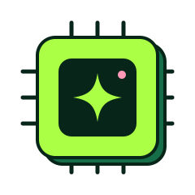

```{=html}
<section class="fn-hero fn-hero--lime">
  
  <span class="eyebrow">StellarGrok · the AI blog</span>
  <h1 class="extrude">AI</h1>
  <p class="lead">Models, evaluations, prompts and the occasional agent.</p>
</section>
```
