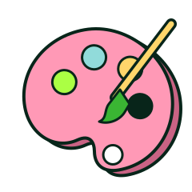

```{=html}
<section class="fn-hero fn-hero--pink">
  
  <span class="eyebrow">StellarGrok · the Art blog</span>
  <h1 class="extrude">Art</h1>
  <p class="lead">Generative pieces, creative coding and visual experiments.</p>
</section>
```
