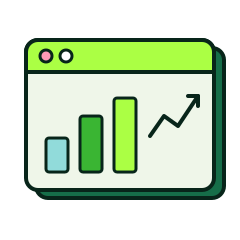

```{=html}
<section class="fn-hero fn-hero--mint">
  
  <span class="eyebrow">StellarGrok · the Data blog</span>
  <h1 class="extrude">Data</h1>
  <p class="lead">Analysis, visualisation and the pipelines behind them.</p>
</section>
```
