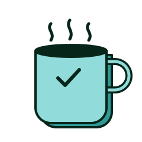

```{=html}
<section class="fn-hero fn-hero--forest">
  
  <span class="eyebrow">StellarGrok · the Other blog</span>
  <h1 class="extrude">Other</h1>
  <p class="lead">Everything that doesn't fit neatly anywhere else.</p>
</section>
```
